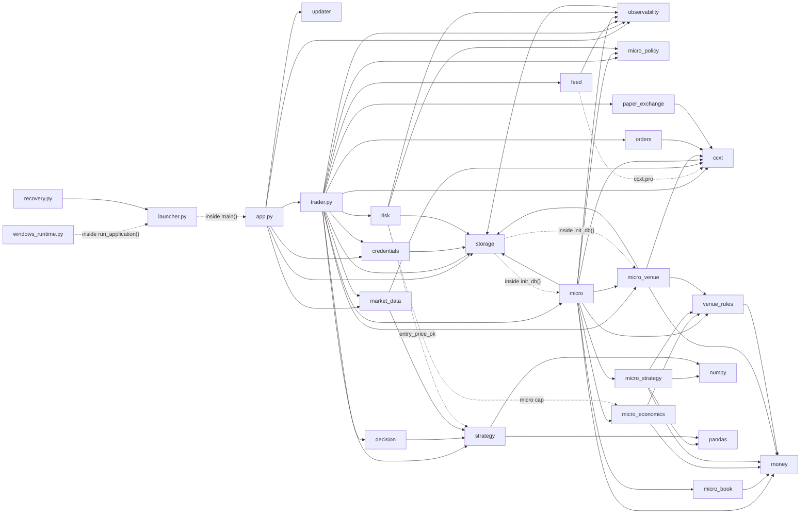

# Architecture

The system as it is on 2026-11-04 (branch `claude/project-thread-jztv7v`,
commit `fdb27c9`), how it maps onto the fifteen modules named in the
improvement brief, and the incremental path between the two. Every
`file:line` below was resolved against that commit by the script that
generated this document, so a reference names the definition it points at.
The recommendation is **not** to rewrite: the single-process design is
sound for one operator on one PC, the boundaries that matter for capital
(risk gate, durable order journal, ledger transaction) exist and are
tested, and the remaining gaps are extractions, not redesigns.

## 1. Runtime shape

One Python process on the operator's PC. `launcher.py` (`main`
`launcher.py:200`) takes an instance lock, binds a loopback
socket (port from `CRYPTOPILOT_PORT`, default 8765), imports `app`, which
constructs the single `TradingEngine` at import time
(`app.py:27`), and runs uvicorn on that socket. FastAPI routes
in `app.py` serve the dashboard (`static/`) and a JSON API guarded by a
loopback check, an origin check and a per-session CSRF token. The engine
owns one daemon worker thread (`start` `trader.py:605`, body
`_loop` `trader.py:682`) that alternates a protective monitor
tick (`_monitor_if_due` `trader.py:835`) with candle
scans (`scan_once` `trader.py:2103`) in the classic
horizons, or hands each tick to the paper-only micro manager (`micro.py`)
when the micro horizon is selected. An optional second daemon thread
streams best bid and ask over websockets (`feed.QuoteFeed`
`feed.py:80`). All state is one SQLite file under the data
directory plus `settings.json`, the OS keyring for API keys and a rotated
JSON-lines event log. Exchanges (MEXC, Kraken spot) are reached through
CCXT; paper mode routes the same submit, confirm and journal path to an
in-process `PaperExchange` (`paper_exchange.py:65`).

Thread model: the engine worker (`trader.py:605`), the
websocket feed with its own asyncio loop (`feed.py:116`), and
uvicorn's thread, from which the API handlers call engine methods. The
shutdown hook (`app.py:35`) stops the engine and waits up to
30 s for the worker to go idle before the server exits. Shared engine state
is guarded by one lock; the protective tick and the scan never run
concurrently because both run on the worker thread.

### Data flow from ingestion to a completed order

```mermaid
flowchart TD
  subgraph ING["Market ingestion"]
    CCXT["ccxt REST client<br/>TradingEngine._new_exchange trader.py:142"]
    MD["market_data.MarketData market_data.py:21<br/>read (retry + breaker) :105, tickers :223, quotes :234,<br/>order_book :214, candles :275, prefetch :339"]
    WS["feed.QuoteFeed feed.py:80 (ccxt.pro, daemon thread)<br/>_stream :295, _ingest :422, ticker :171"]
    QUOTE["TradingEngine._quote trader.py:796<br/>stream overlay over the REST ticker"]
    OBS["TradingEngine._observe_ticker trader.py:1061<br/>mark, volume, spread, freshness"]
  end
  CCXT --> MD
  WS --> QUOTE
  MD --> QUOTE
  QUOTE --> OBS

  subgraph FEAT["Features and regime"]
    IND["strategy.frame_from_ohlcv :47 + strategy.indicators :137<br/>called inside market_data._download :313"]
    REG["strategy.regime_signal :298<br/>TradingEngine._market_regime trader.py:2325 (BTC/USDT higher timeframe gate)"]
  end
  MD --> IND
  IND --> REG

  subgraph SCAN["Classic entry path on the worker thread"]
    S1["scan_once trader.py:2103: _universe :995,<br/>tickers, prefetch, _quote, _observe_ticker, candles (primary and higher timeframe)"]
    S2["decision.evaluate_entry decision.py:103<br/>(strategy.entry_signal :237, setup_quality :282, entry_price_ok :20)"]
    S3["decision.DecisionLog :243 + observability.event decision.entry"]
    S4["candidates -> _enter_candidates trader.py:2560 -> _enter_pass :2570<br/>(re-quote for the buy, entry_price_ok, stop_fraction :319, _entry_budget :2347)"]
    S5["_buy trader.py:1674"]
  end
  OBS --> S1
  REG --> S2
  S1 --> S2 --> S3 --> S4 --> S5

  subgraph AUTH["Risk gate (independent module)"]
    A1["TradingEngine._authorize trader.py:1640 builds risk.OrderRequest risk.py:61"]
    A2["risk.RiskGate.authorize risk.py:508<br/>mode scope, live halt, kill switch, order bounds, exposure, positions,<br/>daily loss, drawdown, loss streak, spread, price move, ATR, volume share,<br/>order rate, rejection spike, failure breaker, slippage breaker"]
    A3["risk.Authorization risk.py:95, TTL 30 s<br/>valid_for :107, RiskGate.issued :402"]
  end
  S5 --> A1 --> A2 --> A3

  subgraph SUB["TradingEngine._submit trader.py:1380 (paper, live and micro share it)"]
    B1["refuse unless the authorization is fresh, matches the request and was issued by this gate"]
    B2["storage.create_order_intent storage.py:538 -> journal 'pending'<br/>client order id derived from the intent id"]
    B3["kill switch and stop re-checked (risk.switch_blocks :146);<br/>submitted_at stamped; event execution.submitted"]
    B4["venue.create_market_buy_order_with_cost / create_order"]
    B5["journal 'acked' (id returned) or 'submitted' (no id)"]
    B6["_confirm_filled trader.py:1279 (fetch_order, orders.locate orders.py:134)"]
    B7["journal 'filled'; _resolve_fees :1315; event execution.filled"]
    BX["orders.Unfilled :27 -> 'rejected'<br/>orders.definite_rejections :54 (incl. ConfirmedRefusal :41) -> 'rejected' + risk.record_failure :366<br/>anything else -> _locate_after_ambiguity :1349, then 'uncertain' + _halt_uncertain :1181 in live"]
  end
  A3 --> B1 --> B2 --> B3 --> B4
  B4 --> VENUE
  VENUE --> B5 --> B6 --> B7
  B4 -.-> BX
  B6 -.-> BX

  subgraph VENUE["Venue (CCXT-shaped duck type, chosen by mode at the call site)"]
    PX["paper_exchange.PaperExchange :65 (id 'paper')<br/>_book_fill :139, _accept :190, fetch_order :251"]
    LX["live ccxt client (private keys loaded by _ensure_private trader.py:460)"]
    MV["micro_venue.MicroPaperVenue micro_venue.py:312 (id 'paper-micro')<br/>rows in paper_venue_orders"]
  end

  subgraph LEDGER["Ledger transaction (same SQLite transaction as the journal 'accounted' update)"]
    L1["_buy: meta paper_cash, UPDATE/INSERT positions, INSERT trades, meta last_entry"]
    L2["_sell trader.py:1830: meta paper_cash, UPDATE positions, INSERT trades, meta last_exit"]
  end
  B7 --> L1
  L1 --> E1["event ledger.accounted; _observe_fills :2024"]
  L2 --> E2["event ledger.accounted; risk.observe_realized :230, observe_exit :300"]

  subgraph PROT["Protective tick (every loop iteration, both horizons)"]
    P1["_monitor_if_due trader.py:835: bulk quotes, per-position quote, _mark_positions :2058"]
    P2["_protect_positions :2044 -> decision.evaluate_exit decision.py:209 -> _sell"]
    P3["failures: _report_exit_failure :1234 (audit, event, metric, dashboard)"]
  end
  P1 --> P2 --> L2
  P2 -.-> P3

  subgraph OBSV["Observability sinks"]
    EV["observability.event observability.py:124 -> events.jsonl (rotated)<br/>observability.METRICS :242; storage.audit storage.py:515 (300 rows, deduplicated)"]
  end
  E1 --> EV
  E2 --> EV
  B3 --> EV
  B7 --> EV

  subgraph OPER["Operator path"]
    JS["static/dashboard.js -> dashboard-core.js requestJson (X-CryptoPilot-Token)"]
    ROUTES["app.py routes: /api/state :138, /api/start :229, /api/stop :234,<br/>/api/order :239, /api/risk :269, /api/config :224, /api/mode :219,<br/>/api/connect :207, /api/reset-paper :257, /api/backtest :343, /api/micro :293"]
    ENG["TradingEngine.start/stop, manual_trade :2381, update_config :514,<br/>set_mode :476, connect :357, snapshot :2786"]
    RG["RiskGate.engage_kill_switch :155 / release_kill_switch :168 / status :679"]
  end
  JS --> ROUTES --> ENG
  ROUTES --> RG
  ENG --> S5
  ENG --> P2
```



Supporting processes: `updater.py` (GitHub Releases polling and install),
`windows_runtime.py` and `maintenance/update_installation.py` (frozen
runtime and source updates), `recovery.py` (offline settings and halt
recovery CLI: `clear_halt` `recovery.py:228`,
`prepare_downgrade` `recovery.py:299`).
`scripts/micro_soak.py` constructs a `TradingEngine` directly in an isolated
data directory without the web server. Research lives in `research/` and
benchmarks in `benchmarks/`; neither is shipped.

## 2. Module dependency map

Imports between the application's top-level modules at the commit above
(test, research and benchmark modules excluded). Arrows point from the
importer to the imported module; dotted arrows are function-local imports.



| Module | Lines | Role |
|---|---:|---|
| `trader.py` | 2,869 | engine: loop, scan, sizing, entry and exit paths, submit and confirm, ledger booking, valuation, snapshot |
| `micro.py`, `micro_*.py`, `money.py`, `venue_rules.py` | 6,842 | 25 USDT paper micro-trading subsystem (Decimal money, synthetic books, cycle state machine) |
| `storage.py` | 673 | SQLite schema and migrations, settings validation and bounds, order journal state machine, audit log, paper reset |
| `strategy.py` | 678 | indicators, entry and exit signals per horizon, the backtester |
| `risk.py` | 695 | the independent risk gate: limits, latches, breakers, kill switch, authorization registry |
| `app.py` | 384 | FastAPI routes, request models, CSRF token, loopback and origin guards |
| `market_data.py`, `feed.py` | 838 | REST candles and tickers with caching, retry and prefetch; websocket best bid and ask |
| `decision.py` | 267 | entry and exit decision records with ids and reasons, bounded decision log |
| `paper_exchange.py` | 267 | in-process exchange for paper mode (book-walking fills, fees, failure injection) |
| `orders.py` | 177 | order classification, client order ids, fill summary, venue refusal detection |
| `observability.py` | 261 | structured events with correlation ids, metrics, redaction, write-failure reporting |
| `credentials.py`, `updater.py`, `launcher.py`, `recovery.py`, `windows_runtime.py` | 1,304 | keyring credentials, updates, process lifecycle, recovery CLI, frozen runtime |
| `static/` | 709 | dashboard (vanilla JavaScript, no build step) |
| `tests/` | 60 files | fakes for both exchanges and the venue; no network |

Cycles and hubs: `storage -> micro -> storage` and `storage -> micro_venue
-> storage` exist and are broken only by the function-local imports inside
`init_db` (`storage.py:398`); `risk -> strategy` and
`risk -> micro_economics` are likewise function-local. `storage` is the hub
by fan-in (imported by `app`, `credentials`, `micro`, `micro_venue`,
`observability`, `risk`, `trader`); `money` is the hub of the micro
subsystem; `strategy` is imported by `decision`, `market_data`, `trader`
and lazily by `risk`.

## 3. Order lifecycle as implemented

Every order, paper or live, classic or micro, is a durable row in
`order_journal` whose transitions are enforced by
`storage.update_order_intent` (`storage.py:577`)
against `ORDER_TRANSITIONS` (`storage.py:566`):

```
'pending':   {'submitted', 'acked', 'rejected', 'uncertain'},
'submitted': {'acked', 'filled', 'rejected', 'uncertain'},
'acked':     {'filled', 'uncertain', 'rejected'},
'filled':    {'accounted', 'uncertain'},
'uncertain': {'reconciled', 'filled', 'accounted'},
'accounted': set(), 'rejected': set(), 'reconciled': set(),
```

```mermaid
stateDiagram-v2
  [*] --> pending : create_order_intent after RiskGate.authorize; submitted_at stamped before the request leaves
  pending --> rejected : stopped or kill switch before sending; definite rejection; never-sent live intent at start-up
  pending --> acked : the venue returned an order id
  pending --> submitted : the call returned without an id
  pending --> uncertain : ambiguous transport error, no order located
  submitted --> acked
  submitted --> filled
  submitted --> rejected
  submitted --> uncertain
  acked --> filled : _confirm_filled saw a final state with a fill
  acked --> rejected : final state with zero fill (orders.Unfilled)
  acked --> uncertain : confirmation failed
  filled --> accounted : ledger transaction committed
  filled --> uncertain : ledger write failed (live: durable halt)
  uncertain --> filled : probe_unresolved located the order at start-up
  uncertain --> accounted : operator acknowledged a booked outcome (recovery --clear-halt)
  uncertain --> reconciled : operator reconciled by hand (recovery --clear-halt)
  accounted --> [*]
  rejected --> [*]
  reconciled --> [*]
```

Mapping to the brief's target lifecycle:

| Target state | Implemented equivalent | Evidence |
|---|---|---|
| CREATED | `pending` row inserted by `create_order_intent` | `storage.py:538`, called from `_submit` |
| RISK_APPROVED | not a journal state; an in-memory `risk.Authorization` with a 30 s TTL, issued before the intent exists and verified by `_submit` (`valid_for` and `RiskGate.issued`); the decision id is written on the row | `risk.py:95`, `risk.py:402`, `trader.py:1380` |
| SUBMITTING | `pending` with `submitted_at` stamped immediately before the venue call; the stamp is what lets `reject_never_sent_live_intents` close intents that never left | `storage.py:638` |
| ACKNOWLEDGED | `acked` (id returned) or `submitted` (no id returned) | `trader.py:1380` |
| PARTIALLY_FILLED | no distinct state: a final order with a partial fill is journaled `filled` with `filled_quantity`; an open partial keeps `acked` while `_confirm_filled` polls; micro cycles track partials in their own table | `trader.py:1279`, `micro.py` |
| FILLED | `filled`, then `accounted` once the ledger transaction commits | `trader.py:1674`, `trader.py:1830` |
| CANCELLED | no state: a cancelled order with a fill is `filled`; cancelled with zero fill raises `orders.Unfilled` and is journaled `rejected` | `orders.py:24` |
| REJECTED | `rejected` | `trader.py:1380` |
| EXPIRED | no state: `expired` is a final status folded into the same `Unfilled` path (market orders only; nothing rests) | `orders.py:24` |

States with no target equivalent: `uncertain` (ambiguous outcome; in live
mode `_halt_uncertain` writes a durable halt that only the recovery CLI
clears), `accounted` (ledger committed) and `reconciled` (operator
resolution). The micro mode layers a second state machine over the journal
(`micro.STATES` `micro.py:53`: ENTRY_RESERVED, ENTRY_SUBMITTED,
ENTRY_UNKNOWN, HOLDING, EXIT_SUBMITTED, EXIT_UNKNOWN, REVIEW, CLOSED,
ABANDONED) and its paper venue keeps CCXT-style order rows in
`paper_venue_orders`.

## 4. The brief's fifteen modules against the current code

| Brief module | Where it lives | Separation note |
|---|---|---|
| MarketDataService | `market_data.MarketData` (`market_data.py:21`), `feed.QuoteFeed` (`feed.py:80`); the stream-over-REST overlay and freshness bookkeeping are engine methods (`_quote`, `_observe_ticker`) | fetching is a module; the overlay is fused into the engine, and `market_data._download` computes indicators during download, so data service and feature engineering are coupled |
| FeatureEngineeringEngine | `strategy.frame_from_ohlcv` (`strategy.py:47`), `strategy.indicators` (`strategy.py:137`); `micro_strategy.compute_features` (`micro_strategy.py:375`) | pure pandas and numpy functions; two independent feature stacks (classic, micro) |
| MarketRegimeDetector | `strategy.regime_signal` (`strategy.py:298`), `trend_signal`, `trend_broken`; `TradingEngine._market_regime` (`trader.py:2325`); `micro_strategy.classify_regime` | regime math is pure; the market-wide BTC gate, its cache and the per-symbol call sit in the engine |
| StrategyEngine | `strategy.entry_signal`, `setup_quality`, `trail_armed`, `stop_fraction`, `trend_size_scale`; `decision.evaluate_entry` (`decision.py:103`), `evaluate_exit` (`decision.py:209`), `DecisionLog`; `micro_strategy.evaluate_entry`/`evaluate_exit` | `decision.py` is pure and replayable (hashed decision ids); candidate ranking and same-candle gating remain in `scan_once` and `_same_candle_blocked` (`trader.py:2707`) |
| SignalValidationEngine | `decision.evaluate_entry` filters; `_enter_pass` re-quote and `entry_price_ok`; `_same_candle_blocked`; `RiskGate.authorize` spread, price-move, ATR and volume-share checks | no dedicated module; validation is split across decision, engine and gate |
| PortfolioConstructionEngine | `TradingEngine._entry_budget` (`trader.py:2347`), `_portfolio_risk` (`trader.py:2341`), `_enter_candidates`, `_enter_pass`; `micro_economics.size_entry` (`micro_economics.py:625`); gate checks on positions and exposure | embedded in the engine (classic) and `micro_economics` (micro); first extraction candidate |
| RiskManagementEngine | `risk.RiskGate` (`risk.py:114`): `authorize`, kill switch, drawdown stop, loss streak, daily loss, rejection-spike, failure and slippage breakers, `issued` registry, `status`; `micro_policy.live_refusal` | cleanest boundary in the codebase: `_submit` refuses without a fresh, issued authorization; the gate still receives engine state (positions, cash, equity) by argument |
| ExecutionManagementSystem | `TradingEngine._submit` (`trader.py:1380`), `_confirm_filled`, `_resolve_fees`, `_locate_after_ambiguity`, `_fill_details` (`trader.py:1538`), `_buy`, `_sell`; `orders.py` helpers | a method cluster of about 600 lines inside the engine; `orders.py` holds the pure classification |
| ExchangeAdapter | live `_new_exchange` (`trader.py:142`) and `_ensure_private`; paper `PaperExchange`; micro `MicroPaperVenue`; websocket `feed.default_client_factory`; `venue_rules.VenueRules` (`venue_rules.py:98`) | duck-typed on CCXT method names; no abstract interface; the engine picks the venue by mode at each call site |
| OrderAndFillReconciliationService | `storage.update_order_intent`, `unresolved_orders` (`storage.py:610`), `abandon_stale_paper_intents`, `reject_never_sent_live_intents`; `TradingEngine.probe_unresolved` (`trader.py:402`), `_audit_unbooked_live_fills` (`trader.py:266`); `recovery.clear_halt`; `micro.recover_on_startup`, `apply_recovery` | the durable state machine is in `storage`; reconciliation logic is split between the start-up probe, the micro recovery and the offline CLI |
| PortfolioAccountingLedger | tables `positions`, `trades`, `meta` (`paper_cash`, `last_entry`, `last_exit`); writes inline in `_buy` and `_sell` inside the journal transaction; micro `_book_entry`/`_book_exit`; readers `_active_positions`, `_cash` (`trader.py:1024`), `_equity` (`trader.py:1152`) | atomic with the journal `accounted` transition, but no ledger module; classic rows are floats, micro money is Decimal stored as text |
| BacktestingAndSimulationEngine | `strategy.backtest` (`strategy.py:365`), `research_report`; `/api/backtest`; `research/classic_walkforward.py`, `research/trend_rotation.py`, `research/metrics.py`; fill simulation in `PaperExchange._book_fill` and `MicroPaperVenue._accept` | the backtester shares only indicators with the live path; paper mode is the full-path simulation |
| MonitoringAndAlertingService | `observability.event` (`observability.py:124`), `METRICS`, `last_write_error`; `storage.audit`; `/api/state`, `/api/metrics`, `/api/decisions`; dashboard warnings | clean module; sinks are the event file, in-memory metrics and the audit table; the dashboard poll is the only alert channel (no email or push) |
| ConfigurationAndSecretsManager | `storage.DEFAULTS` (`storage.py:25`), `validate_settings` (`storage.py:102`), `settings`, `save_settings`; `credentials.load`/`save`/`delete` (`credentials.py:51`) | settings share `storage.py` with the database layer; secrets are isolated in `credentials.py` and never stored in SQLite |
| PersistenceAndRecoveryService | `storage.connection` (`storage.py:356`, foreign keys on, synchronous FULL), `_require_intact` (`storage.py:387`, `PRAGMA quick_check`), `init_db` (WAL, migrations, `user_version`), `reset_paper`; `micro.ensure_schema`, `micro_venue.ensure_schema`; `recovery.main` | one-file persistence layer plus an offline tool; micro schema lives in the micro modules and is pulled in lazily |

Persistence surfaces: `portfolio.sqlite3` (tables `meta`, `audit`,
`positions`, `trades`, `order_journal` with indexes on status, scope, client
order id and decision id; `micro_cycles`, `micro_cycle_events`,
`paper_venue_orders`), `settings.json`, the OS keyring and
`logs/events.jsonl`. The paper reset deletes paper-scoped rows from every
table and the scoped `meta` keys; live rows are never touched by it.

## 5. Incremental path (no rewrite)

1. Extract `portfolio.py` (sizing and the portfolio-risk calculation) and
   `execution.py` (submit, confirm, fill details, fee resolution) from
   `trader.py` behind the same function signatures, with the existing tests
   unchanged. This is mechanical and leaves the engine class with the loop,
   the scan and the ledger.
2. Move the paper reset's micro clean-up into `micro.py` so `storage` no
   longer imports feature modules, and give `risk` its two lazy imports as
   arguments instead.
3. Add a `reconcile` module around `probe_unresolved`,
   `_audit_unbooked_live_fills` and `--clear-halt` that can also book a
   confirmed-but-unbooked live fill (today such a fill is named at start-up
   and booked by hand; roadmap R-2).
4. Record PARTIALLY_FILLED, CANCELLED and EXPIRED as journal notes rather
   than states: market orders only, nothing rests, so the three target
   states collapse into `filled` or `rejected` here, and the note already
   carries the venue status. A distinct state is only needed once resting
   or exchange-placed stop orders exist (roadmap R-3).
5. Keep the single process and the single SQLite file: the operator runs
   one account on one machine; a message bus or a service split would add
   failure modes without a capital benefit.
