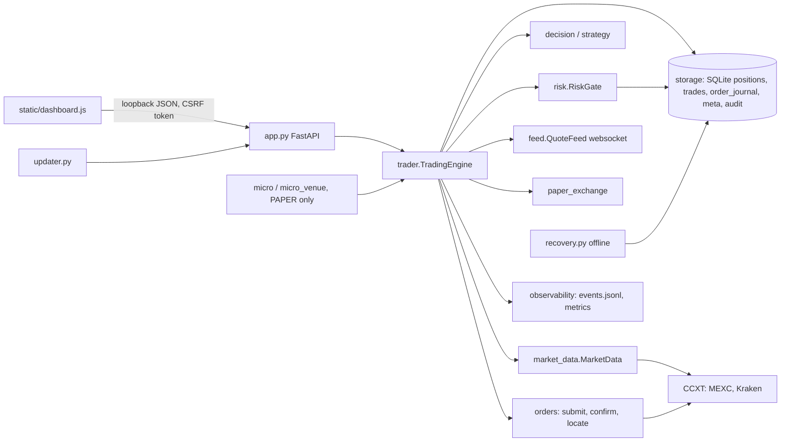

# Forensic audit report

CryptoPilot ATB, main `b1db421` (release v1.5.146), audited 2026-11-04 on
branch `claude/project-thread-jztv7v`. Paper mode throughout; no live
trading was enabled, no exchange was reached (the audit container has no
route to MEXC or Kraken), no credential was read. Every number in this
report comes from the repository, its committed research outputs, or a test
run in the container; nothing is estimated from memory.

Severity scale: **critical** (unbounded or systematic loss of capital),
**high** (bounded loss of capital, or protection silently absent),
**medium** (wrong accounting, a control weaker than documented, or an
unanswered failure), **low** (operator confusion, opportunity cost, hygiene),
**info** (noted for completeness). Classification follows the brief:
*confirmed defect* (reproduced by a test or an experiment in this
container), *suspected defect* (consistent reading of the code and the
exchange documentation, not reproducible offline), *design risk* (works as
designed, the design falls short of the brief's bar), *unverified assumption*
(a premise the code relies on that only a connected machine can check).

## 1. Summary

* **Initial state**: 1,658 tests passing, no known-vulnerable dependency,
  no secret in the history, a careful hardening history (PRs #5, #6, #8,
  #10 to #15) and a loopback-only API with CSRF, CSP and strict input
  models. The code is far better than a typical hobby bot; it is not yet at
  the brief's "enterprise grade" bar, mainly in three places: the protection
  of open positions depends on one process on one PC, the recovery tooling
  could discard a real fill, and the software supply chain trusts GitHub
  alone.
* **Defects**: 49 confirmed defects fixed on this branch with regression
  tests (section 5.1), 10 confirmed defects deferred with reasons (5.2),
  3 suspected defects that need a connected machine (5.3), 79 design risks
  with a roadmap item or an explicit acceptance each (5.4), and 6
  assumptions to verify on the operator's PC (5.5). An independent
  verification pass (one adversarial agent per medium-or-worse finding,
  the base commit extracted for before/after runs) confirmed every defect,
  found three fixes incomplete, which were completed (F-30, F-31, F-44),
  and refuted one premise, which was fixed (F-38). The order-lifecycle lens
  reported after that pass had finished; its findings were verified by
  reading the code at the branch head and by the lens's own probe tests
  (section 6). The most consequential
  fixes: a fault outside the order path (a locked database during a
  protective poll) no longer switches off every stored exit behind a durable
  halt that needed the offline tool; the protective monitor no longer sells Trend positions on a
  trailing stop the strategy never had; candle completion uses a measured
  exchange clock on both venues; one rejected exit can no longer starve
  every other position's exit; the recovery tool no longer discards a
  filled-but-unbooked order; a settings rollback can no longer silently
  loosen a cap.
* **Edge**: none demonstrated. The committed research shows the shipped
  Trend variant's validation Sharpe (0.55) below the expected maximum of
  the 26 portfolio-level variants tried on the same data (0.52 for pure
  noise is the bar; the best variant reached 0.65 and the shipped one, after
  adjusting for the number of trials, has a deflated Sharpe of 0.51); the
  plain Trend holdout lost (-2.2 % mean trade, t = -1.9) and the Position
  holdout is 19 trades. Five forward paper cycles since 2026-10-30 are net
  negative. `PROFITABILITY_ANALYSIS.md` has the tables and the exact
  commands to rerun them on real data.
* **Verdict**: not ready for live capital (`PRODUCTION_READINESS.md`); ready
  for a long forward paper run on the operator's PC with this branch
  installed, which is the only thing that can produce the missing evidence.

## 2. Verified initial state

| Check | Result on `b1db421` (container, CPython 3.13, Linux) |
|---|---|
| `python -m pytest -q tests/` | 1,658 passed, 2 warnings, 339 s |
| `node --test tests/test_dashboard.js` | 24 passed |
| `pip-audit` on the three lock files | no known vulnerabilities (2026-11-04) |
| `ruff` (E9, F) | 2 unused locals (`trader.py` `slip`, `fee_rate`), no errors |
| `bandit` | S608 on constant table names only; B023 closures called in the loop; S310 on the updater's opener (HTTPS enforced) |
| git history secret scan | test fixtures only (the source-archive guard's own tests); no credential, no private key |
| Exchanges from the container | unreachable (MEXC, Kraken, Binance all refused); only github.com and PyPI |
| Research data | `research/data/` (real candles) is not in the repository; only result summaries are committed |
| Size | `trader.py` 2,700 lines holding engine, execution, portfolio and reconciliation; 13 other modules; 47 test files |

## 3. Method

Sixteen reading lenses (accounting, execution, risk, strategy, market data,
persistence, concurrency, security, micro, venue, dashboard, research,
observability, tests, lifecycle, and an architecture mapper) each read the
whole subsystem in its charge, ran experiments in an isolated data folder
where a claim could be exercised offline, and reported findings with file
and line, cause, evidence, financial consequence and a proposed fix,
classified as above. Findings rated medium or worse are then handed to
independent verifiers prompted to refute them; verdicts are recorded in
section 6 as they arrive. The author of this report fixed what was
confirmed and capital-relevant, in small commits with regression tests
(`IMPLEMENTATION_CHANGELOG.md`), and recorded the rest in
`CRITICAL_DEFECTS.md` and `IMPROVEMENT_ROADMAP.md`.

Two things the method cannot do: reach an exchange (so Kraken's client
order id format, MEXC's ticker clock and the paper engine's cost realism
stay unverified), and read the real candle data (so the equity-level
statistics were reported as NOT RUN rather than estimated). The second
gap was closed after the audit: on 2026-11-04 the operator's PC reran the
harness on the real candles, read-only, and `PROFITABILITY_ANALYSIS.md`
section 3.4 carries the measured values with the run record.

## 4. Architecture

The full map (runtime shape, module dependency graph, order-state machine,
the brief's fifteen target modules against the current code, and the
incremental path) is `ARCHITECTURE.md`. In one picture:

Order lifecycle as implemented (`storage.ORDER_TRANSITIONS`): `pending` →
`submitted` | `acked` | `rejected` | `uncertain`; `submitted` → `acked` |
`filled` | `rejected` | `uncertain`; `acked` → `filled` | `uncertain` |
`rejected`; `filled` → `accounted` | `uncertain`; `uncertain` →
`reconciled` | `filled` | `accounted`. The brief's `CREATED`,
`RISK_APPROVED`, `SUBMITTING`, `ACKNOWLEDGED`, `PARTIALLY_FILLED`, `FILLED`,
`CANCELLED`, `REJECTED`, `EXPIRED` map onto these as shown in
`ARCHITECTURE.md` section 3 (line references resolved against the branch
head). The states the journal lacks are a partial fill, a cancellation and
an expiry, because every order is a market order confirmed to a final state
before it is booked: a final state with a fill is `filled`, with none it is
`rejected`, and the venue status is kept in the row's note.

## 5. Findings

Lens ids (`accounting-1`) are the finders' numbering; `F-`, `D-`, `S-` and
`U-` ids are the register in `CRITICAL_DEFECTS.md`.

### 5.1 Confirmed defects, fixed on this branch

| Lens id | Register | Severity | Defect | Location | Cause | Financial consequence | Fix | Verification |
|---|---|---|---|---|---|---|---|---|
| strategy-1 | F-3 | high | the protective monitor trailed Trend positions with a 2.5-ATR stop the strategy never defined | `trader.py` 817-824, 1987-1991, 1873-1892 | the scan passed no ATR for Trend, the monitor passed the cached daily ATR | every Trend position sold on an ordinary 8-20 % pullback after gaining one ATR; the forward paper run tested a rule the app did not apply | monitor passes no ATR for the Trend horizon (`4dcf3e2`) | `test_audit_fixes.py::test_the_monitor_does_not_trail_trend_positions` |
| strategy-2, marketdata-1, marketdata-2, marketdata-6, strategy-7 | F-4 | high | candle completion, scan timing and the re-entry marker used the PC clock on Kraken and CCXT's hourly figure on MEXC | `market_data.py` 150-156, 267-283; `trader.py` 986-999, 1766-1770 | no server-time measurement on Kraken; MEXC's offset refreshed only with the catalogue | a still-open candle's partial close became the signal; after a PC clock correction every exchange-stamped quote was rejected for up to an hour, silencing trailing and trend exits | local-minus-server measured from `fetch_time` on both venues, refreshed every 15 min and on a rejected quote at most once a minute (`4dcf3e2`, `7776711`) | `test_audit_fixes.py` clock tests (`TimedExchange`) |
| risk-1 | F-5 | high | the runaway exit-rate bound counted every order on the exchange | `risk.py` 575-577 | one rejected protective exit retried every poll used the shared allowance | every other position's protective exit refused for the minute: unbounded loss below the stored stop | counted per pair (`2e940b7`) | `test_audit_fixes.py::test_one_pairs_rejected_exits_do_not_starve_another_pairs_exit` |
| accounting-2 | F-1 | high | a manual buy that merged a dust remainder anchored stop, target and high on the blended average | `trader.py` 1569-1582, 1796-1808 | the merge used the position's average entry | a remainder from a higher earlier entry put the stop above the bid; the merged position was sold at the next poll (probe: -11.25 USDT on a 215 USDT merge) | anchored on the new fill, basis blended (`6046041`) | `test_accounting_fixes.py::test_merged_dust_anchors_stop_target_and_high_on_the_new_fill` |
| accounting-1, execution-5 | F-2 | medium | a MEXC buy whose fees could not be read was booked at the gross quantity with a quote-side estimate | `trader.py` 1377-1381, 1551 | MEXC bills a market buy's commission in the asset received | tracked units exceeded the holding by the commission; every exit left an unsellable phantom that kept the pair `held` | fee deducted from the base quantity on MEXC buys; sub-minimum live shortfalls written off on a full exit (`6046041`) | `test_accounting_fixes.py` (9) |
| accounting-3, execution-4 | F-6 | medium | a verified dust remainder withheld its pair from automated entries for good | `trader.py` 2331-2335, 1962-1967 | only a manual buy could merge dust | on MEXC live every pair left the entry universe after its first round trip | scan entries consolidate verified dust, anchored on the new fill (`2e940b7`) | `test_audit_fixes.py::test_a_scan_entry_consolidates_a_verified_dust_remainder` |
| marketdata-5 | F-7 | medium | any exception on the exit path in the protective tick was reported as "Protective quotes unavailable" | `trader.py` 803-836 | one try block around quote and exit | a breached stop stayed open while the operator chased quotes | exit failures audited and shown as such, `monitor.exit_error` event (`7776711`) | `test_audit_fixes.py` monitor error tests |
| (hardening 6) | F-8 | medium | protective exits serialised behind one balance read each | `trader.py` `_sell` | each exit read the account before selling | several breaching positions waited a round trip apiece | one read per tick, reused within 3 s (`f0cdb06`) | `test_audit_fixes.py::test_protective_exits_of_one_tick_share_a_single_balance_read` |
| persistence-2 | F-14 | medium | a settings file lacking a later-added key silently restored that cap's default once a last-good copy existed | `storage.py` `_read_settings_file`, `_settings_state` | completeness required only the pre-1.3.0 keys | lens experiment: per-order cap 100 to 1000 USDT, realised-loss latch 1 % to 3 %, health `ok` | a changed later-added key is required; its absence is `invalid_values` (`8a47698`) | `test_persistence_fixes.py` settings tests |
| accounting-5 | F-9 | low | the live snapshot read the paper cash ledger unconditionally | `trader.py` 925-931, 2512 | `_cash('paper')` raised on a corrupt row | `GET /api/state` offline in live mode | `paper_cash: null` in live mode (`2e940b7`) | `test_audit_fixes.py::test_live_snapshot_survives_a_corrupt_paper_ledger` |
| risk-10 | F-10 | low | a paper reset kept the consecutive-loss record | `storage.py` 615 | key not in the reset's delete list | a fresh paper account started latched | cleared with the other latches (`2e940b7`) | `test_audit_fixes.py::test_paper_reset_clears_the_consecutive_loss_record` |
| marketdata-9 | F-11 | low | Kraken's bulk ticker read failed for every scan once the universe held one unlisted pair | `trader.py` 1929-1937 | tickers requested before the catalogue filter | scan latency and rate budget | filtered first (`7776711`) | `test_audit_fixes.py` |
| marketdata-7, marketdata-8 | F-12 | low | feed rebuilt on a reorder; prefetch outlived Stop | `feed.py` 150-154; `market_data.py` 292-319 | tuple comparison; no cancel | reconnect churn; rate budget | set comparison; cancellable prefetch (`7776711`) | `test_quote_feed.py`, `test_audit_fixes.py` |
| persistence-1 | F-13 | high (design risk, closed) | `--clear-halt` reconciled a filled-but-unbooked live intent, dropping the fill from the ledger | `recovery.py` 184-240 | one UPDATE over every unresolved row, bypassing the state machine | after a BUY an untracked, unprotected holding; after a SELL a phantom position | refuses and names each fill; `--acknowledge-unbooked-fills` after a manual correction; report shows the fill (`8a47698`) | `test_persistence_fixes.py` clear-halt tests |
| persistence-3 | F-15 | low | the loss streak was a counter written after the sell committed | `risk.py` 251-297 | a crash in between lost the loss | the stop engaged one trade late | count read from the trade ledger; latches at the next check (`8a47698`) | `test_persistence_fixes.py` streak tests |
| persistence-4 | F-16 | low | live holdings invisible in paper mode (hardening 20) | `trader.py` 82, snapshot | state listed the current mode's positions only | a stored stop breached while the operator believes nothing is held | `live_positions`, dashboard warning, audit line (`8a47698`) | `test_persistence_fixes.py::test_live_positions_are_counted_and_warned_about_in_paper_mode` |
| persistence-7 | F-17 | low | a never-sent live intent halted live trading until the offline tool ran | `storage.unresolved_orders` | no equivalent of the micro recovery's `_never_sent` | protective exits refused meanwhile | closed at start (`8a47698`) | `test_persistence_fixes.py::test_live_intents_that_never_left_are_closed_at_startup` |
| persistence-10 | F-18 | low | no integrity check before migrations | `storage.init_db` | none existed | a damaged ledger migrated as it was | `PRAGMA quick_check` first, `DatabaseDamaged` (`8a47698`) | `test_persistence_fixes.py::test_a_damaged_ledger_is_refused_before_any_migration` |
| persistence-8 | F-19 | low | stale paper intents abandoned only for the exchange configured at start | `storage.py` 589-601 | one call site | none (paper) | called on the switch (`8a47698`) | `test_persistence_fixes.py` |
| concurrency-1 | F-20 | low | a Stop in the worker's final feed close stuck as "Stopping" | `trader.py` 602-614 | `stopping` from thread liveness alone | update refused; runbook's wait never ends | `stopping` requires `running` (`9dd80e7`) | `test_audit_fixes.py` |
| concurrency-3 | F-21 | low | every dashboard scan lost its prefetch after the first Stop | `trader.py` 2012 | the sticky stop event | slower manual scans | worker scans only (`9dd80e7`) | `test_audit_fixes.py` |
| security-6 | F-22 | low | an oversized integer setting raised `OverflowError` past the 400 mapping | `storage.py` 115-118 | `math.isfinite` on a huge int | a spurious service-failure line | treated as out of bounds (`9dd80e7`) | `test_persistence_fixes.py` |
| venue-1 | F-23 | high | a venue error outside `definite_rejections()` became `uncertain` after a lookup that found nothing: a durable halt that switched off every other position's protective exit | `trader.py` `_submit`; `orders.py` 39-47 | the lookup's "absent" answer was not distinguished from a failed lookup | unbounded loss on every other live position during the halt | confirmed refusal journaled `rejected` (`bdf318e`) | `test_venue_fixes.py` (4) |
| venue-3 | F-24 | medium | 2x and 4x leveraged tokens passed the spot filter | `trader.py` `_spot` | a suffix list of 3x and 5x only | an entry in a decaying leveraged product | any single-digit multiple excluded (`bdf318e`) | `test_review_fixes.py` |
| venue-4 | F-25 | low | a sub-step remainder above the minimums was not dust and blocked every entry | `trader.py` `_is_dust` | no step rule | opportunity cost | under one fractional step is dust (`bdf318e`) | `test_venue_fixes.py` |
| micro-5, micro-6 | F-26 | low (PAPER) | a float rounding residue read as a late fill; the ownership fallback silently removed the monitor from all paper positions | `micro.py` | no tolerance; no audit | simulated only | tolerance; warning and metric (`bdf318e`) | `test_venue_fixes.py` |
| dashboard-2 | F-27 | medium | a corrupt paper-cash row failed the whole state read, taking the kill switch off the page; a `ValueError` action promised an activity line it never wrote | `trader.py` `snapshot`, `app.py` `ensure_ok` | unguarded paper `_cash`; the 400 branch skipped `_record_failure` | the operator loses the kill switch during a ledger fault | `ledger_error` in the state; the line is written (`0595d23`) | `test_dashboard_fixes.py` |
| dashboard-1 | F-28 | medium | the kill switch was disabled whenever one poll failed; only Stop (which ends stop monitoring) stayed usable | `static/dashboard.js` `updateControls` | gated on `online` | blocking new entries during a hiccup meant disabling every protective exit | engage follows the Stop rule (`0595d23`) | `test_dashboard_browser.cjs` |
| dashboard-3 | F-29 | medium | open circuit breakers were never shown; a restart silently cancels the in-memory failures hold | `static/dashboard.js` `render` | `breakers_open` ignored by the page | entries resume into the same failing condition after a restart | one banner line per open breaker (`0595d23`) | `test_dashboard.js`, `test_dashboard_browser.cjs` |
| verification F-6 | F-30 | medium | F-6's fix was unreachable from `scan_once` (the decision still read dust as held) | `trader.py` `scan_once` | `held_now` without the dust distinction | a dust pair stayed withheld for good | dust ignored in the scan's held check (`0595d23`) | `test_audit_fixes.py` (end to end through `scan_once`) |
| verification F-8 | F-31 | medium | the shared balance read did not carry a sale's proceeds to the next exit of the tick, so its realised-loss check could latch the durable daily stop early | `trader.py` `_sell` | USDT not credited; base fee not deducted; cache kept after a buy | a durable latch on an understated equity | credit, deduct, discard after a buy (`b5aad01`) | `test_audit_fixes.py` |
| research-1 | F-32 | high (research) | the rotation simulator bought a stopped coin back at the same day's open, so every stop was charged without removing the exposure | `research/trend_rotation.py` steps 1-4 | only rotation sells were excluded from the day's purchases | the stop conclusion behind PR #15's 20 % cap bound is unsupported | `trend-rotation-v2`; doc corrected (`af80516`) | `test_trend_rotation.py` |
| dashboard-11 | F-33 | low | dust quantities displayed as zeros | `static/dashboard.js` | `fmt(qty, 7)` | operator cannot see the holding | non-zero-preserving formatter (`0595d23`) | `test_dashboard_browser.cjs` |
| verification F-7 | F-34 | low | an audit write failing in the tick's exit handler ended the tick | `trader.py` `_monitor_if_due` | unguarded write in an `except` | the other positions' checks skipped | guarded (`0595d23`) | existing exit-failure test |
| observability-2 | F-35 | medium | a protective exit failing during the scan was shown as "Scan unavailable" only | `trader.py` `scan_once` | per-symbol handler swallowed it | the operator chases the wrong cause while the exit is unsent | reported like a monitor failure (`35bba10`) | `test_observability_fixes.py` |
| observability-3 | F-36 | medium | a failed trailing-level write halted live trading durably as an order uncertainty | `trader.py` `_mark_positions` | routed to `_ledger_failure` | every stop unmonitored after a local write hiccup | a monitoring fault with the symbol and the stored stop (`35bba10`) | `test_observability_fixes.py` |
| observability-11 | F-37 | medium | a confirmed refusal whose report line failed became `uncertain` | `trader.py` `_submit` | one try around journal and reports | a halt for a reconciliation of nothing | the journal's refusal stands (`35bba10`) | `test_observability_fixes.py` |
| verification D-2 | F-38 | medium | F-23 read a bare `ExchangeError` with no body as the venue's answer | `orders.py` | CCXT synthesises the class for unclassified transports | a possibly accepted order journaled `rejected` | the venue's JSON body is required (`35bba10`) | `test_venue_fixes.py` |
| observability-4, -8, -9 | F-39 | medium | event-log append and rotation failures swallowed; oversized lines cut into invalid JSON | `observability.py` | `except: pass`; post-serialisation slice | the incident trail silently incomplete | counted, shown, audited once; fields bounded (`35bba10`) | `test_observability_fixes.py` |
| observability-5 | F-40 | medium | the activity table deduplicated against its latest row only | `storage.py` `audit` | `LIMIT 1` | alternating lines flush the history that explains the positions | a 20-row window, one copy moved to the top (`35bba10`) | `test_observability_fixes.py`, `test_review_fixes.py` |
| tests-4 | F-41 | medium | the execution-failure breaker lived in memory; a restart lifted it | `risk.py` `record_failure` | no meta row | entries resume into the failing condition | stored like the slippage hold (`35bba10`) | `test_observability_fixes.py` |
| tests-1 | F-42 | medium | `_submit` accepted any authorization object with `allowed=True` | `trader.py` `_submit`, `risk.py` | token logged, never checked | the gate bypassable from inside the process | a registry of issued tokens (`35bba10`) | `test_observability_fixes.py` |
| observability-7, -1 | F-43 | low | a paper worker crash and protective quote failures left no durable trace | `trader.py` | in-memory fields only | the page cannot say why the bot stopped | activity lines and events (`35bba10`) | `test_observability_fixes.py` |
| verification CTRL | F-44 | low | `max_consecutive_losses = 0` kept a stored latch | `risk.py` `_latch_at_limit` | stored `latched_at` returned regardless of the limit | entries blocked although the control reads off | a zero limit holds no latch (`549d987`) | `test_risk_governance.py` |
| verification D-1 | F-45 | low | nothing in the running app named a filled-but-unbooked live intent | `trader.py` `__init__` | start-up audited other cases only | the operator does not see what the exchange holds unprotected | a start-up line per such fill (`35bba10`) | `test_persistence_fixes.py` |
| lifecycle-1 | F-46 | high | any exception escaping the worker loop wrote the durable live halt, so a locked database during a protective poll switched off every stored exit and refused Start and the manual ticket until the offline tool was run, with nothing to reconcile | `trader.py` `_loop` (703-704 at `35bba10`), `_ledger_failure`, `_halt_uncertain` | the loop's catch-all reused the ledger-failure path, whose live branch is the durable halt reserved for an unknown order outcome | every open live position unprotected from the fault until `--clear-halt` is run; the operator cannot close them through the app meanwhile | `_worker_failure`: the halt is durable only while a live order outcome is open (or the journal is unreadable); otherwise the worker stops, the cause is recorded and Start resumes the stored exits (`fdb27c9`) | `test_lifecycle_fixes.py` (4 tests: live without and with an open intent, unreadable journal, paper) |
| lifecycle-2 | F-47 | medium | a settings save that changed the exchange committed the settings file, the configuration and the ledger scope before its one database write, so a failure there left the engine quoting and simulating on the old venue under the new scope (paper only: an exchange change requires paper mode) | `trader.py` `update_config` (546-558 at `35bba10`) | the stale-intent clean-up ran after the commit points | the Kraken-scoped paper ledger and journal receive positions priced and filled on MEXC until a restart; no live order can be sent in that state | the clean-up runs before anything is committed (`fdb27c9`) | `::test_a_failed_exchange_switch_changes_nothing`, `::test_a_successful_exchange_switch_still_closes_the_stale_intents_of_the_new_exchange` |
| lifecycle-4 | F-48 | low | the scan's trailing pass resubmitted a stored exit at the bid the protective poll had just tried (three orders per scan for a stuck exit instead of two) | `trader.py` `scan_once` (2154-2173 at `35bba10`) | the pass compared against the scan's earlier bid, not the poll's | each extra rejection counts toward the rejection-spike breaker and the per-pair exit-rate bound, so the pause arrives sooner than designed; no duplicate fill is possible | the pass is told the bid the poll tried (`fdb27c9`) | `::test_the_scan_does_not_resubmit_a_stored_exit_at_the_bid_the_poll_tried` |
| lifecycle-5 | F-49 | low | every Trend pair was reported with regime `weak` and its recorded confidence halved, and the decision record stored `regime_ok=false`, for a confirmation timeframe the Trend rule does not read | `trader.py` `scan_once` (2121, 2180, 2247 at `35bba10`) | the generic regime input was hard-wired to False for Trend | none (operator information and the replayable record; ranking uses setup quality, so no order changed) | Trend carries no regime gate: the field is empty and the record states that no gate applied (`fdb27c9`) | `::test_trend_assessments_carry_no_regime_gate` |

### 5.2 Confirmed defects, deferred with reasons

| Lens id | Register | Severity | Defect | Why deferred | Instead |
|---|---|---|---|---|---|
| execution-2 | D-1 | high (design risk) | a confirmed live fill that fails to book is never booked afterwards | booking needs the fill's fee, which the journal does not store; a recovery step that writes the ledger is a larger change | the tool now refuses to discard it (F-13); roadmap R-2 (`--book-fill`) |
| execution-3 | D-2 | medium | definite pre-acceptance refusals outside `definite_rejections()` (MEXC 700003, `InvalidNonce`, 429) become `uncertain` and a durable halt | the halt is the safe side; widening the definite list needs each venue's documented error semantics checked on a connected machine | roadmap R-5/venue lens; the runbook's `--clear-halt` after the report |
| marketdata-3 | D-3 | medium | an exchange-wide rate-limit cooldown of 30-300 s also blocks protective quote reads | the cooldown exists to avoid a ban; a held-symbol probe budget needs the venue's `Retry-After` semantics | streaming quotes mitigate it; roadmap R-6 |
| marketdata-4 | D-4 | medium | a rejected candle history silently disables that symbol's trailing and trend exit | keeping a degraded frame for exits needs a rule for how old is too old | roadmap R-6 (per-pair data health, degraded fallback) |
| concurrency-2 | (open) | low | one scan pass can submit the same rejected stored-stop exit two or three times | needs a shared per-position, per-price guard across three paths; bounded today by the per-pair exit-rate limit (F-5) | roadmap R-7 |
| concurrency-4, security-4 | (open) | low | the in-app update's idle check is unlocked, incomplete and not latched (hardening 23) | the window is 1.5 s and an order past `_submit` completes before exit | roadmap R-12 |
| strategy-5, strategy-6 | (open) | low | Trend decisions show a "weak" regime and halved confidence; the Trend research backtest demands weekly candles it ignores | display and research only; no order is affected | roadmap R-6 (Trend rows show regime n/a; backtest skips the weekly requirement for Trend) |
| micro-1 | D-5 | medium (PAPER) | a carried dust remainder's embedded loss is counted against the new micro cycle's stop | the fix changes the micro sizing model; simulated capital only | roadmap R-17 |
| micro-2 | D-6 | medium (PAPER, suspected) | a closed residual between the limit and market minimums is unsellable by the micro rules yet not dust to the engine | the two dust definitions must be unified | roadmap R-17 |

### 5.3 Suspected defects (not confirmable offline)

| Lens id | Register | Severity | Suspicion | What would confirm it |
|---|---|---|---|---|
| execution-1 | S-1 | high | Kraken client order ids are 32 undashed hexadecimal characters; if Kraken enforces its documented `cl_ord_id` format, every Kraken live order, protective exits included, is refused (fails closed). Verification: undetermined offline; the repository comment that named `userref` was wrong for CCXT 4.5 (corrected); a refusal would now be journaled `rejected` after a clean lookup (F-23, F-38) rather than halting | the `AddOrder` `validate: true` dry run (L11), then one 12 USDT manual order on a Kraken account with the kill switch allowing exits |
| execution-7 | S-2 | low | `probe_unresolved` on Kraken reads `ClosedOrders` from timestamp 0 without pagination or the server-side filter, so an older intent can be reported as not found | a Kraken account with more than one page of closed orders |
| execution-6 | S-3 | medium | Kraken `viqc` market-buy fill units are assumed base-denominated; the price-consistency check cannot detect the wrong unit (verification: CCXT recomputes Kraken's cost from average and filled, so the ratio is always 1; a misbook is confined to pairs under about 1.03 USDT, above which the budget guard halts instead) | a 12 USDT manual buy on Kraken of a pair priced **below 1 USDT**, comparing the journal's `filled_quantity` with the account and with Kraken's raw `info.cost` |

### 5.4 Design risks

| Lens id | Severity | Risk | Status |
|---|---|---|---|
| risk-6, concurrency-5 | medium | every stop is a software stop in one process; Stop and Ctrl+C disable protective exits at once | G1, L10; roadmap R-3 (exchange-placed stops); until then the kill switch with exits allowed is the "stop entries, keep exits" mode |
| risk-2 | medium | an authorization is not bound to the order's notional and can be reused within its 30 s TTL | no caller does so today; roadmap R-13 binds the token to cost and quantity during the extraction |
| risk-3 | medium | the meme-basket caps live in sizing, not in the independent gate | roadmap R-4 (cluster cap in the gate) |
| risk-4 | medium | day-scoped baselines: the daily guard resets on a depressed baseline and a drawdown clear resets the peak | G4; `RISK_MANAGEMENT_SPEC.md`; roadmap R-14 may tighten the profile |
| risk-5 | medium | no pre-trade slippage bound | G3; roadmap R-5 |
| strategy-3 | medium | the backtest's trailing stop, entry timing and cost model differ from the engine's | `BACKTEST_VALIDATION.md`; roadmap R-6 |
| strategy-4 | medium | Trend parameters chosen on reused validation data from a survivorship-biased universe | `PROFITABILITY_ANALYSIS.md` selection adjustment; roadmap R-16 (pre-registered research) |
| security-1 | high | the in-app update trusts GitHub alone; auto-release on every merge; no code signature | `SECURITY_REVIEW.md` SL-1; roadmap R-10 |
| security-2 | medium | the release pipeline resolves every third-party input by a mutable name | SL-2; roadmap R-10 |
| security-3 | medium | the loopback token is CSRF protection, not authentication | SL-3, S4 accepted; roadmap R-11 |
| accounting-4 | low | live equity from the free USDT balance moves with deposits and withdrawals | G5; roadmap R-13 (ledger-derived live equity) |
| accounting-6 | low | the equity haircut uses the configurable fee and slippage, and Kraken's taker fee is 2.6× the default estimate | the paper engine resolves the venue rate; roadmap R-13 values equity with it |
| accounting-7 | info | `trades` rows are asymmetric in how base fees appear | documented in `ARCHITECTURE.md`; roadmap R-15 |
| risk-7 | low | no explicit venue-health requirement in the gate | G7; roadmap R-6 feeds it from the market-data counters |
| risk-8 | low | latches other than the kill switch are not carried across an exchange change | G6; roadmap R-11 |
| risk-9 | low | an unobserved symbol is judged quote-fresh on the supplied price | no production caller; roadmap R-13 fails it closed |
| strategy-8 | low | the anti-chase band is symmetric, so a breakout can be bought below the signal close | roadmap R-16 (test a one-sided band under a protocol) |
| marketdata-10 | low | MEXC quote time basis rests on the ticker's `closeTime` | U-1 |
| marketdata-11 | info | feed liveness inferred from quote arrival only | roadmap R-15 |
| persistence-5 | low | live latches and the ledger are scoped per exchange, not per API identity | fail-closed; roadmap R-11 resets them on a fingerprint change |
| persistence-6 | low | `--prepare-downgrade` drops accounted paper intents of open micro cycles | paper only; roadmap R-15 refuses while a micro cycle is open |
| persistence-9 | low | the activity log's deduplication hides when a repeated condition began | roadmap R-15 |
| persistence-11 | low | legacy live records block live trading with no repair tool | fail-closed; roadmap R-2 adds a confirmed repair |
| persistence-12, persistence-13, persistence-14 | info | version marker rewritten by an older build; latch stored before its event; one connection per call | roadmap R-15 |
| concurrency-6 | low | an external SQLite lock halts the bot after 15 s | roadmap R-8 |
| security-5 | low | a pasted non-key is added to the redaction set before validation | accepted (the alternative leaks a real secret on a failed connect) |
| security-7 | low | a pre-finding-38 credential keeps roaming persistence | open by choice; roadmap R-11 |
| risk-11 | info | the three new controls were uncommitted when the lens read the tree | committed since (`9ec9262`) |
| venue-2 | medium (assumption) | Kraken live parameters (`oflags fciq,viqc`, 32-hex client id) have never been exercised; a refusal means no Kraken entry works, a quote-denominated fill means an untracked holding | S-1, S-3; `PRODUCTION_READINESS.md` adds a Kraken `validate: true` dry run and one 12 USDT order before any Kraken live use |
| venue-5 | low | the authenticated client's catalogue is loaded once at connect; live orders take precision and limits from it with no age check | roadmap R-6 (reload with the public catalogue; refuse rules older than a bound) |
| venue-6 | low | the venue rules modelled in `venue_rules.py` (side permissions, market-order cost bounds, Kraken `ordermin`) are not applied by the classic engine before sending | roadmap R-5 (build `VenueRules` in `_buy`/`_sell` as the micro manager does) |
| venue-7 | low | paper mode applies no venue precision or minimum rules, so a paper soak cannot surface sub-step remainders or minimum-notional refusals | roadmap R-6 (route paper orders through the same precision and limit checks) |
| micro-3, micro-4, micro-7 | low/info (PAPER) | a safety exit on a thin top-of-book snapshot is submitted and its rejections feed the breakers; the sizing counts the taker fee twice; the paper "confirmed" result equals the estimate by construction | roadmap R-17; the research notes state the identity |
| micro-8 | info | PAPER-only boundary verified: no micro path reaches a live client | `tests/test_micro_refusal.py` remains the guard |
| dashboard-4 | medium | no risk-utilisation view: exposure against caps, drawdown from peak, today's realised P/L against the daily stop are not displayed; the realised tile is all-time | roadmap R-18 |
| dashboard-5 | medium | Start in an armed live session is a single unconfirmed click beside Scan now | roadmap R-19 |
| dashboard-6 | medium | the settings form is the only view of what runs, is not re-synced after the first state and has no unsaved-changes marker; no regime field is exported | roadmap R-18 |
| dashboard-7 | medium | "Emergency stop" is an orderly stop that leaves positions open and ends stop monitoring; no flatten-all action for the main strategies | roadmap R-18; until then the kill switch is the emergency control and the page says so in its tooltip |
| dashboard-8 | medium | vetoed entries and rejected orders have no view beyond the latest `risk_block` string and the activity list; `/api/decisions` has no page | roadmap R-18 |
| dashboard-9 | low | any live intent in flight is announced as "unresolved order(s) require reconciliation" for the seconds it is in flight | roadmap R-18 |
| dashboard-10 | low | "Last scan" is the attempt time; per-pair quote age, market-data counters and the feed state are not rendered outside one sentence | roadmap R-18 |
| dashboard-12 | low | no net or per-horizon performance view; the trades table records no horizon | roadmap R-18 (additive column) |
| dashboard-13 | low | hardening finding 21 still open: a timed-out manual order cannot be re-asked with its `request_id` | roadmap R-18 |
| dashboard-14 | info | the signal score reads like a probability | roadmap R-18 (label it as a rule count) |
| research-2 | medium | the seven-year candle set cannot be regenerated or verified from the repository (no committed collector for `_long.json`, no data fingerprint in the results) | roadmap R-20 |
| research-3 | medium | the 2025-05 to 2026-10 holdout has been read at least six times, once before the protocol existed; the band variant was designed with holdout behaviour known | roadmap R-20; `PRODUCTION_READINESS.md` L2 therefore counts only the forward paper run as out of sample |
| research-4 | medium | 46 to 51 variants read the same years; the deflated Sharpe of every "selected" portfolio variant is inside the expected maximum of noise, and the doc reports none of it | `PROFITABILITY_ANALYSIS.md` section 3.3; roadmap R-20 |
| research-5 | medium | no simulation uses the app's account: the classic figures are means of eleven single-pair sleeves, the portfolio studies size 12.5 % slots fully invested | roadmap R-20 (single-account replay with the app's gate) |
| research-6 | medium | all 32 research pairs are 2026 survivors; development-period eligibility thresholds inherit the survivorship | roadmap R-20; stated on every development figure in `PROFITABILITY_ANALYSIS.md` |
| research-7 | low | flat 0.05 % + 0.05 % cost model, no spread, lot or minimum; the "doubled" stress is below Kraken's 0.26 % taker fee | roadmap R-20 (`kraken` cost row) |
| research-8 | low | the random-entry benchmark under-trades the strategy and uses 30 seeds | roadmap R-20 |
| research-9 | low | open positions at a split's end are excluded from the classic mean-trade figures but counted in the sleeve studies | roadmap R-20 |
| research-10 | low | `dip_research`: 220-bar EMA(200) warm-up, split-end exit at the next split's open, flat gap-filled entry bars | roadmap R-20; the study's verdict (no edge) is robust to them |
| research-11 | info | the Monte Carlo comment described a year of trades; the horizon is the split's trade count | comment corrected (`af80516`) |
| observability-6 | medium | no health endpoint, worker watchdog, monitor-age check or notification channel: a hung worker or a stalled protection shows as "Running" | roadmap R-21 |
| observability-10 | low | correlation gaps on failure paths: `monitor.exit_error` carries no decision id; the halt and crash events carry no symbol or intent | roadmap R-15 |
| observability-12 | low | latch records store state, then audit, then event (hardening H.9 open) | roadmap R-15 |
| observability-13 | low | no escalation after repeated protective-exit failures beyond the collapsing activity line (hardening H.4 open) | roadmap R-7 |
| tests-2 | medium | continuous integration runs only pytest on Windows 3.14: no Linux job, lint, dependency scan, Node suite or replay check; actions pinned by major tag | roadmap R-9, R-10 |
| tests-3 | medium | the classic paper venue applies no venue limit or precision, so paper and live diverge on remainders and minimums; the live checks are tested only against a two-decimal fake | roadmap R-6 (venue-7) |
| tests-5 | low | no property-based tests over money, quantisation, sizing and fill arithmetic | roadmap R-22 |
| tests-6 | low | no concurrency test of duplicate manual submission on the classic engine | roadmap R-22 |
| tests-7 | low | the classic ledger does its money arithmetic in binary floats and its "exact" test asserts with a tolerance | roadmap R-22 (conservation test) |
| tests-8 | low | `trades.order_id` has no uniqueness and the fake venue mints one id for every fill, so a double booking of one exchange fill is unpinned | roadmap R-22 (unique partial index; distinct fake ids) |
| tests-9 | low | no test rebuilds the ledger from the journal or events; `benchmarks/replay.py` runs nowhere automatically | roadmap R-9 (replay in CI), R-22 |
| tests-11 | low | test-quality anti-patterns: a swallowed exception around a call under test, an operator-precedence assert, either-or asserts, range-only asserts | roadmap R-22 |
| lifecycle-3 | medium | a manual buy is an ordinary position of its horizon, so the next scan sells it on the completed-candle trend reversal (last primary close below EMA50) whatever the operator intended; in live mode that is an unrequested market sell (reproduced on `35bba10`) | D-7; no behaviour change on this branch (a change to what a manual position's exits are is a strategy decision for the operator); roadmap R-23 |
| lifecycle-6 | low | hardening finding 24 stays open: the protective tick ends with a paced private balance read (at most every 30 s, and after every fill) inside the tick | accepted: one private request per 30 s; R-21's health figures will show the tick length it adds |
| lifecycle-7 | low | hardening finding 6 is only partly closed: the exits of one tick share the balance read but are still submitted and confirmed one after another, so the later positions in a fast move are sold seconds after the first | accepted until R-3 (exchange-placed stops remove the dependency on the tick); submitting several exits without waiting is a concurrency change the single-thread design was chosen to avoid (R-7 notes it) |
| lifecycle-8 | info | Trend volatility scaling applies to automated entries but not to the manual ticket's cap (PAPER only at every boundary) | roadmap R-23 (manual ticket semantics); the forward run's record mixes scaled and unscaled sizes only if the operator buys by hand |

### 5.5 Unverified assumptions

| Lens id | Register | Assumption | How to verify |
|---|---|---|---|
| marketdata-10 | U-1 | MEXC's 24 h ticker `closeTime` tracks the exchange's current time | log `closeTime` minus `fetch_time` on an active and an illiquid pair over a few minutes on a connected machine |
| (research) | U-2 | the paper engine's fills at the quoted side plus the configured slippage reproduce live costs on MEXC (0.05 % taker) | compare paper fills with the first manual 12 USDT live orders' fills |
| execution-6 | S-3 | Kraken `viqc` market-buy units are base-denominated | one 12 USDT Kraken manual buy |
| research-12 | U-3 | the exchanges' native weekly candles open on Monday 00:00 UTC as the research harness builds them from daily bars | fetch a few native `1w` candles from each exchange and compare their open timestamps |
| research-13 | U-4 | the Balanced walk-forward rows in `docs/CLASSIC_WALKFORWARD.md` (715 and 1,340 validation trades) have a result file behind them | none is committed; rerun under R-20 or drop the rows |
| accounting (verification of F-2) | U-5 | MEXC bills a market buy's commission in the asset received | compare the first live MEXC buy's `fetch_order_trades` fee currency with the booked deduction |

## 6. Coverage and verification status

| Lens | Findings | Status |
|---|---|---|
| accounting | 7 | reported; fixes F-1, F-2, F-6, F-9 |
| execution | 7 | reported; D-1, D-2, S-1, S-2, S-3, F-2, F-6 |
| risk | 11 | reported; F-5, F-10; design risks above |
| strategy | 8 | reported; F-3, F-4; deferred display items |
| market data | 11 | reported; F-4, F-7, F-11, F-12; D-3, D-4 |
| persistence | 14 | reported; F-13 to F-19 |
| concurrency | 6 | reported; F-20, F-21; R-7, R-8, R-12 |
| security | 7 | reported; F-22; `SECURITY_REVIEW.md` section 4 |
| venue | 7 | reported; F-23, F-24, F-25; venue-2 added to the readiness checklist |
| micro | 8 | reported; F-26; D-5, D-6 (PAPER only) |
| dashboard | 14 | reported; F-27, F-28, F-29, F-33; R-18, R-19 |
| research | 13 | reported; F-32 (simulator); R-20; U-3, U-4 |
| observability | 13 | reported; F-35, F-36, F-37, F-39, F-40, F-43; R-21, R-15, R-7 |
| tests | 11 | reported; F-41, F-42; R-9, R-22; one finding (a red test in the shared working tree during the audit) was the in-progress snapshot change, committed with its test updated |
| lifecycle | 8 | reported after the verification pass; F-46, F-47, F-48, F-49; D-7; design risks lifecycle-6 to -8; R-23 |
| architecture map | map | `ARCHITECTURE.md` regenerated from it, every line reference resolved against the branch head by the generating script |
| adversarial verification of medium-or-worse findings | 16 of 16 verdicts in; the lifecycle lens's two medium-or-worse findings (F-46, F-47) and its design risk D-7 arrived after that pass had finished and were verified by reading the code at the branch head and by the lens's probe tests, which reproduced each one at `35bba10` and were turned into the regression tests, not by a separate adversarial agent | every defect confirmed (two suspected ones remain undetermined offline, with sharper checks); three fixes found partial and completed (F-30, F-31, F-44); one premise refuted and fixed (F-38); one handler guarded (F-34); one start-up line added (F-45); three wordings corrected (F-13, F-14, D-1); the table is in `CRITICAL_DEFECTS.md` section 4 |

## 7. What this audit did not do

It did not place or simulate a live order against an exchange, read any
credential, change a strategy parameter or a default, enable live trading,
or read the Trend holdout a second time. It did not measure anything on real
candle data: `BACKTEST_VALIDATION.md` and `PROFITABILITY_ANALYSIS.md` said
exactly which numbers were therefore NOT RUN and how to run them; the
operator's PC ran them on 2026-11-04 (`PROFITABILITY_ANALYSIS.md` section
3.4), which did not change the verdict.
